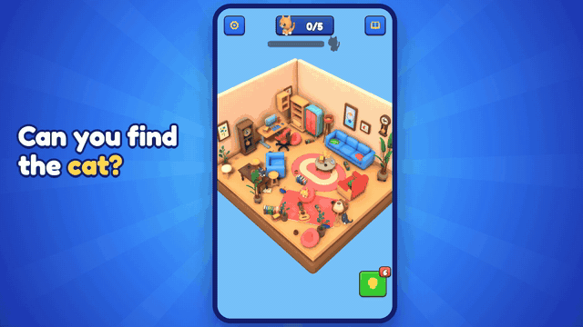
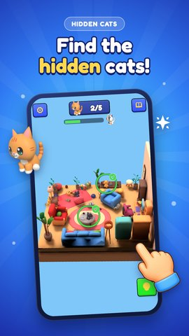
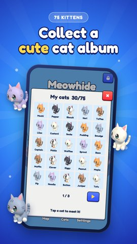
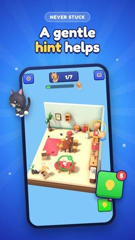

  

<h3 align="center">Calm, kid-safe mobile games, made with care and tested by robots before every release.</h3>

  <a href="https://pippitygames.com">Website</a> ·
  <a href="https://www.youtube.com/@pippitygames">YouTube</a> ·
  <a href="https://www.linkedin.com/company/pippity-games/">LinkedIn</a> ·
  <a href="mailto:hello@pippitygames.com">hello@pippitygames.com</a>

---

## Our games

<table>
<tr>
<td width="170" valign="top"></td>
<td valign="top">

### Meowhide: Find Hidden Cats
A calm 3D seek-and-find game for kids and families. Spin cozy little rooms, peek into boxes and find every hidden kitten.
**Android, coming soon to Google Play.**

- 75 levels in 5 rooms, 75 collectible kittens
- Unity 6.3 LTS (URP), low-poly art from our own Blender pipeline
- No ads, no purchases, no data collected, no permissions, plays offline
- Built for the Google Play Families policy: target API 36, 16 KB page support

</td>
</tr>
</table>

   
  
  
  

## How we work

| Area | What we do |
|---|---|
| **Automated QA** | Test bots play every level from a fresh install through the real buttons before each release, and check that every hidden object can be seen and tapped. Meowhide's release build: 75 of 75 levels, 0 failures. |
| **Kid-safe by design** | Google Play Families policy from day one, parent gates on every outside link, honest store pages, no dark patterns. |
| **Own art pipeline** | Scripted low-poly props and palettes in Blender, licensed asset packs logged and checked. |
| **Store-ready launches** | Keyword research, store listing, phone and tablet screenshots, and trailers cut from real gameplay. |

## Work with us

We build mobile games for **publishers, brands and studios**: from the first idea and a playable prototype to a polished, tested release on Google Play. Calm puzzles, hidden-object games and kid-friendly experiences are our home ground.

📮 **hello@pippitygames.com** · 🌐 [pippitygames.com](https://pippitygames.com)
